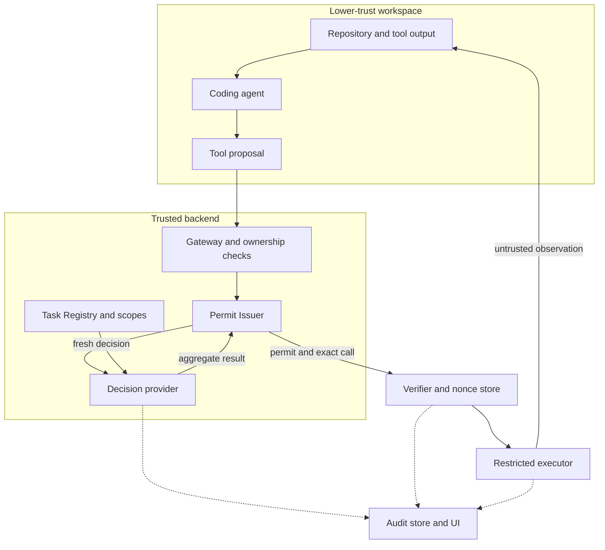
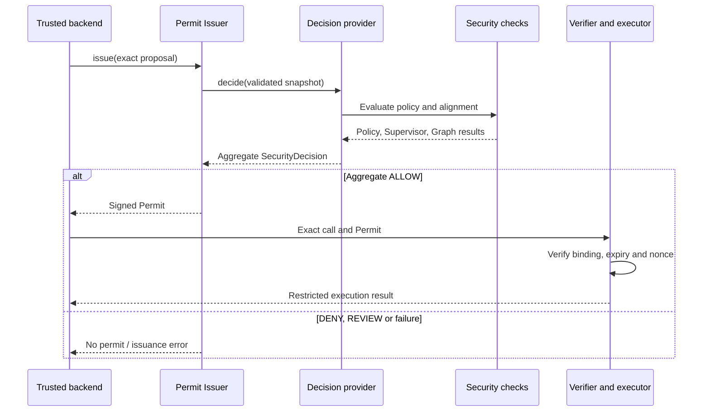

# System Architecture

**Project:** A Secure Execution and Auditing Platform for Turkish Language Coding Agents  
**Document revision:** 0.1.0 — Day 7 documentation  
**Prepared:** 2026-11-06  
**Repository location:** `docs/architecture.md`  
**Shared schema version:** `0.1.0`, unchanged by the Day 5–7 documentation work

## 1. Purpose and implementation scope

The platform mediates a coding agent's operations against a registered Turkish-language user task. A proposed tool call must satisfy independently enforced task permissions and task-alignment checks before the trusted issuer can create a signed permit. Execution requires additional verification and runtime controls at the consumer boundary.

This document describes the inspected Python modules and their intended integration. It distinguishes implementation evidence from required deployment behavior. It is consistent with [threat-model.md](threat-model.md), which records threats, trust boundaries, test evidence and security limitations. [api-contract.md](api-contract.md) supplies the detailed contracts; its Day 5–7 update remains a separate documentation task.

The inspected sources are the generated Day 1–6 modules/configuration/tests used in this workflow, not a complete checkout of the team's latest merged commit. A complete production Gateway, verifier, Graph Inspector, sandbox and database implementation was not reviewed here. A component marked **not verified here** may already exist elsewhere in the project.

Logical components do not imply separate deployed microservices. The current class interfaces support composition inside a trusted Python backend. Untrusted agent/project code must remain outside the process and filesystem privileges that hold issuer keys and authorization configuration.

## 2. Component responsibilities and evidence

| Component | Responsibility | Inspected interface or source | Evidence status |
| --- | --- | --- | --- |
| User interface / task ingress | Receive a user task and associate it with an authenticated owner. | Endpoint and ownership contracts belong to backend integration. | Not verified here. |
| Coding agent / tool adapter | Produce proposed operations and consume lower-trust observations. | `ToolCall` and `ToolResult` in `common/schemas.py`. | Shared contracts inspected; actual agent adapter not reviewed. |
| Gateway / trusted orchestration | Authenticate, check ownership, validate ingress and prevent alternate paths to side effects. | Production endpoint/wiring is not specified by the inspected classes. | Required integration; not verified here. |
| Task Registry and scopes | Maintain trusted task goals and task-to-workspace/scope associations; supply exact grants. | `tasks/registry.py`, `tasks/scope.py`. | Implemented, inspected and used in tests. |
| Policy Engine | Evaluate the exact call against trusted task grants and global Casbin rules. | `security/policy_engine.py`; `configs/casbin_model.conf`, `configs/casbin_policy.csv`. | Real Casbin is exercised in Day 6 tests. |
| Supervisor | Compare a proposal and source observations with the registry-backed goal. | `security/supervisor.py`: `Supervisor.evaluate()`. | Implemented; reviewed tests use scripted LLM responses. |
| Graph Inspector / provenance analysis | Supply source/behavior analysis associated with the same call and context. | Resolver accepts `graph_flag`; the external Graph service schema is not defined here. | Actual inspector not reviewed; its signal is mocked in tests. |
| Decision provider and resolver | Compose fresh checks and return a non-authorizing or authorizing stage result. | `DecisionProvider` callback; `resolve_security_decision()`. | Resolver implemented; concrete composition is demonstrated in the Day 6 test fixture. Production wiring is not verified. |
| Permit Issuer | Revalidate a call, obtain a fresh decision and sign a short-lived permit. | `security/permit_issuer.py`: `PermitIssuer.issue()`. | Real signing and signature checks exercised. |
| Canonical codec | Produce consistent JSON bytes and hash complete tool arguments. | `common/canonical_json.py`. | Implemented and used by issuer/tests. |
| Permit verifier / nonce store | Verify signature/binding/expiry and enforce one-time consumption. | Consumer requirements; no implementation established by the inspected tests. | Not verified here. |
| Restricted executor / sandbox | Perform approved file operations or configured test profiles under runtime restrictions. | Execution module name appeared in a Windows error; full implementation/configuration not reviewed. | Real execution and Docker/gVisor isolation not established by these tests. |
| Audit store / UI | Preserve and display attributable outcomes with access control and sensitive-data handling. | Database/event schemas and UI implementation not reviewed. | Required integration; storage/encryption guarantees not established here. |

A separate Turkish prompt-injection detector, if supplied by another team component, may contribute evidence to trusted decision code. No detector API, training result or automatic approval authority is invented by this document. Neither a detector nor a graph flag replaces policy enforcement.

## 3. Logical topology and trust domains

The following diagram shows the required relationships, not a claim that every edge is deployed. Solid arrows represent call/data relationships rather than evidence status; use Section 2 for implementation status. Dashed arrows are audit observations, not authorization channels.



The issuer invokes the configured provider synchronously during `issue()`. The provider is a trusted callback, not another tool offered to the agent. In the inspected composition it uses Policy Engine, Supervisor and the graph signal before returning the resolver's result. The Gateway is responsible for backend-selected caller/task context before this call starts.

Source text, tool output, model explanations and agent-provided identifiers remain lower-trust inputs even when they arrive through a successful tool result. Administrative configuration, task registration, policy grants and signing authority are not derived from those inputs.

If a remote model provider is used, selected task/proposal/source text crosses an additional data-disclosure boundary. The model supplies an advisory structured assessment; it receives no issuer signing authority. Data minimization and provider handling require separate deployment decisions.

## 4. Data contracts and ownership

| Contract | Authoritative producer | Important fields | Consumer responsibility |
| --- | --- | --- | --- |
| `Task` | Trusted task-registration backend | `task_id`, `user_goal`, `workspace_id`, `scope_id` | Authenticate ownership externally; resolve referenced workspace/scope through the registry. |
| `TaskScope` | Trusted startup configuration | Allowed tools, readable/writable files, listable directories, allowed test profiles | Enforce exact grants; do not infer one permission from another. |
| `ToolCall` | Agent proposal, validated at the backend | `request_id`, `task_id`, `tool`, typed `arguments` | Treat IDs and arguments as untrusted; preserve their validated values for binding. |
| `UntrustedSource` | Backend-collected observation; content/labels remain untrusted | `source_id`, `kind`, `content` | Bind observations to the correct task/workspace/source snapshot; never promote their text to the trusted goal. |
| `SupervisorDecision` | Supervisor after strict response parsing | `verdict`, `reason`, backend-assigned `reason_code` | An `ALIGNED` assessment alone grants no authority. |
| `SecurityDecision` | Policy for its own stage, or trusted provider for aggregation | `decision`, `reason_code` | Distinguish stage results from aggregate approval; only a trusted aggregate `ALLOW` may authorize issuance. |
| `Permit` | Trusted issuer | Task/tool binding, argument hash, nonce, expiry, ID and signature | Verify and consume before execution; shape validation alone is insufficient. |
| `ToolResult` | Executor/backend result boundary | `request_id`, `status`, `output`, `source_id`, `trust_level="untrusted"` | Safely record/render output and preserve provenance; successful output is still untrusted content. |

`SCHEMA_VERSION` is a module constant, not a request field. Unknown fields are rejected by the shared models. The original task goal is not accepted as a replacement field on a tool request. Frozen models prevent ordinary assignment but do not isolate hostile Python code.

### 4.1 Supported operations

| Tool | Arguments | Authorization resource |
| --- | --- | --- |
| `secure_list_files` | Explicit relative `path`, including `.` for the root | Exact listable directory |
| `secure_read_file` | Relative `path` | Exact readable file |
| `secure_edit_file` | Relative `path` and complete replacement `content` | Exact writable file |
| `secure_run_tests` | Trusted configured `profile_id` | Exact allowed test profile |

Edit content is the new whole file, not a patch. Empty text is valid, and whitespace/Unicode/line endings are preserved. A test profile is an identifier, not a submitted command. The executor must resolve profiles using trusted configuration and execute project tests within the restricted runtime.

## 5. Policy and task context

`TaskRegistry` snapshots trusted workspaces/scopes and stores registered tasks in memory. It checks uniqueness and workspace/scope consistency. Its `get()` and `get_scope()` interfaces return revalidated records. It does not authenticate callers, persist tasks or share state across backend processes.

`PolicyEngine` loads explicit model/policy paths at startup. Configuration errors abort construction; request/evaluation errors return a denial in the handled paths. Casbin receives the registry's scope, the validated tool name and the resource selected from its arguments. The enforcer is shared behind a lock within an engine instance.

The reviewed model uses exact grants, independent read/write/list/test permissions and global deny precedence. File tools cannot access protected `.env`, `.env.*` or `.git` path components even through mistakenly explicit grants. Listing a directory does not authorize its descendants or reads of its contents.

Path-schema and Casbin checks do not replace real file-access controls. The executor must enforce workspace containment, symlink/mount handling, race resistance, protected-entry filtering and the semantics of the actual filesystem. Case-sensitive policy matching does not establish safety on case-insensitive volumes.

Policy/model files and test-profile mappings must remain outside agent-editable configuration. The prototype's deployment must protect the backend's own repository independently from an agent workspace.

## 6. Supervisor, sources and graph signals

The Supervisor loads the trusted task from the registry using a backend-selected task ID. It validates the proposal and rejects mismatched task IDs before consulting the LLM. Its JSON input contains `trusted_task`, `untrusted_tool_call` and, when supplied, `untrusted_sources` as separate fields. Agent/source text is not interpolated into the system instructions.

The Day 5 source kinds are `readme`, `code_comment`, `file` and `tool_output`. Source labels do not authenticate provenance. The prompt version is `supervisor-tr-v2`; its instructions explicitly consider Turkish, transliterated, misspelled and mixed-language manipulation, as well as legitimate quotation of attack examples. This is a prompt design, not a measured model-performance guarantee.

| Boundary control | Inspected setting / behavior |
| --- | --- |
| Sources | At most 16 entries; source ID limited to 256 characters |
| Total input | At most 65,536 UTF-8 bytes across the serialized task, proposal and sources; no silent truncation |
| Model output | One JSON object with `verdict` and `reason`; at most 8,192 UTF-8 bytes |
| Verdicts | `ALIGNED`, `MISALIGNED`, `UNCERTAIN` |
| Reason | Non-blank text of at most 1,000 characters; trusted code supplies `reason_code` |
| Invalid output | Duplicate keys, extra fields, malformed data and invalid verdicts yield a non-authorizing fallback in `evaluate()` |
| Provider errors | Handled model failures/timeouts produce `UNCERTAIN`; exceptions are not treated as approval |

The optional `OpenAIResponsesClient` has a configurable provider/model boundary, strict structured output, no agent tools and explicit client shutdown. The caller must choose a supported configured model. Other clients implement `SupervisorLLMClient.complete()` and enforce their own timeouts. Provider access, prompt disclosure and model-quality evaluation are separate from offline contract tests.

The inspected resolver accepts a `graph_flag` of `False`, `True` or missing (`None`). This is a local resolver interface, not a claimed external Graph Inspector API. A trusted adapter must associate the real inspection result with the exact call and source context. A graph flag expresses suspicion; it is not automatically a definitive attack verdict.

## 7. Decision composition and fail-closed behavior

### 7.1 Provider versus resolver

`DecisionProvider` is `Callable[[ToolCall], SecurityDecision]`. It must obtain all required results from trusted backend state, then return an aggregate decision. `resolve_security_decision()` combines supplied results but does not run Policy Engine, call a model, inspect a graph or authenticate the results' origin.

The Day 6 test fixture demonstrates this sequence:

1. Evaluate the exact call with the real Policy Engine. Return a non-`ALLOW` policy result immediately.
2. Evaluate Supervisor alignment using the backend's task context and selected source observations.
3. If Supervisor is not `ALIGNED`, resolve to a blocking result without requesting graph clearance.
4. Otherwise obtain the graph signal for the same call and resolve the results.
5. Return that aggregate decision to the issuer. No agent tool executes inside this callback.

Production integration must supply equivalent enforcement. The test's `_trusted_decision()` helper is not proof that an application endpoint has this wiring. A callback that always returns `ALLOW`, or only checks policy, violates the intended architecture even though its return object may pass schema validation.

### 7.2 Aggregation rules

| Valid policy result | Supervisor result | Graph flag | Aggregate result |
| --- | --- | --- | --- |
| `DENY` | Any, including missing | Any | `DENY` |
| `ALLOW` or `REVIEW` | `MISALIGNED` | Any | `DENY` |
| `REVIEW` | `ALIGNED` or `UNCERTAIN` | Any | `REVIEW` |
| `ALLOW` | `UNCERTAIN` | Any | `REVIEW` |
| `ALLOW` | `ALIGNED` | Strict boolean `False` | Stage `ALLOW` |
| `ALLOW` | `ALIGNED` | `True` | `REVIEW` |
| `ALLOW` | `ALIGNED` | Missing/invalid | `REVIEW` |

Invalid policy input produces `REVIEW`. Invalid Supervisor input produces `REVIEW` unless a valid policy denial already determines the result. Thus invalid policy plus a Supervisor rejection may yield `REVIEW`; both are non-authorizing. Integers and strings are not accepted as graph clearance.

`REVIEW` means withhold the operation. The resolver implements no human-review queue or automatic resumption. A separate authorized backend process would have to resolve review and obtain fresh checks before issuance. Neither `REVIEW` nor an exception may be converted to a fallback permit.

### 7.3 Failure ownership

| Condition | Responsible boundary | Required outcome |
| --- | --- | --- |
| Malformed proposal | Shared validation / issuer ingress | Reject before the decision callback; no permit. |
| Missing/broken trusted policy configuration | Policy startup | Abort initialization rather than serve an unprotected executor. |
| Policy denial or handled evaluation failure | Policy/provider | Stop progression to issuance. |
| Supervisor invalid input, invalid model answer or handled provider failure | Supervisor/provider | `UNCERTAIN`, then a blocking aggregate; no permit. |
| Graph suspicion, missing signal or invalid signal type | Resolver | `REVIEW`; no permit. |
| Unexpected provider or graph exception | Provider/issuer/backend | Propagate/handle as a failed request without issuing a permit. |
| Key load, signing or trusted-clock error | Issuer/backend | Fail startup/request as applicable; return no permit. |
| Invalid signature/binding/expiry or consumed nonce | Real verifier | Reject before any side effect; requires consumer verification. |

## 8. Permit lifecycle and cryptographic representation

The issuer is called with the proposal, not with an agent-provided approval. It revalidates the proposal and passes a separate validated snapshot to its configured provider. Only a validated `SecurityDecision` with `decision="ALLOW"` proceeds to the clock, payload construction and signing.

The following sequence shows the issuer/provider callback relationship and the required consumer boundary. The final verifier/executor step is a deployment requirement; the inspected integration tests replace downstream execution with a Mock sentinel.



### 8.1 Signed payload

| Permit field | Meaning and integrity treatment |
| --- | --- |
| `permit_id` | Issuer-generated UUID4; signed. |
| `task_id` | Registered task binding copied from the validated call; signed. |
| `tool` | Exact tool name copied from the call; signed. |
| `arguments_hash` | SHA-256 of the full canonical argument object; signed. |
| `nonce` | `secrets.token_urlsafe(24)` value; signed; one-time consumption belongs to the verifier. |
| `expires_at` | Aware UTC time plus configured TTL; signed using the representation below. |
| `signature` | Ed25519 signature over all other permit fields; canonical unpadded Base64url encoding. |

`canonical_json_bytes()` delegates RFC 8785 serialization to `rfc8785`. The project's accepted JSON subset excludes floats and unsafe-range integers; code strings and line endings are not normalized. Object keys follow the codec's UTF-16 ordering while output bytes are UTF-8.

`permit_signing_bytes()` excludes `signature` and normalizes expiration to UTC with exactly six fractional digits and `Z`. Issuer and verifier must share this representation; serializing the wire Permit JSON in an arbitrary order is not an interchangeable signing method. The helper reconstructs bytes; it does not verify the signature or enforce expiry.

The default/max TTL is 60 seconds, with allowed integer values from 1 to 60. Expiration is calculated after the synchronous decision call, so this TTL is not an end-to-end decision-service deadline. Issuer operation errors produce no returned permit.

The schema has no `request_id`, audience, `issued_at`, key ID or source/workspace revision digest. `request_id` remains useful for correlation, but is not signed. Registry context must supply the workspace association. Snapshot freshness, consumer separation, key rotation and revocation require explicit protocol/deployment decisions.

### 8.2 Consumer requirements

Before an operation can create a side effect, the real verifier must validate the Permit structure, verify the signature using a trusted public key, match task/tool/argument hash to the exact requested operation, reject expired permits and atomically consume a previously unused nonce. Concurrent consumers must share a suitable atomic nonce mechanism if they serve the same issuance domain.

The executor must then preserve those validated operation values while enforcing its own containment, resource, mount, profile and network rules. A valid signature does not make inserted code safe, prevent exfiltration or automatically apply sandbox restrictions. These consumer properties are not established by issuance tests.

## 9. Deployment and state ownership

| Domain | State/configuration | Placement rule |
| --- | --- | --- |
| Trusted backend | Task Registry, scopes, Policy Engine, Supervisor orchestration and decision composition | Process-local prototype state must remain authoritative and inaccessible to agent code. |
| Issuer authority | Persistent private key, TTL/clock/provider configuration | Only the trusted issuer domain may load/use the key; never an agent-controlled setting or mount. |
| Verifier authority | Trusted public key, current time and nonce-consumption state | Independent consumer checks; public-key origin and atomic shared nonce state must be defined. |
| Agent workspace | Source files, README/comments, test code and generated edits | Treat content as untrusted; keep backend authorization configuration and issuer credentials outside it. |
| Execution runtime | File-operation controls, profile mapping, limits, mounts and egress | Execute untrusted project code/tests with restricted privileges. Docker/gVisor configuration requires runtime verification. |
| Audit storage / UI | Correlated records, protected data and user access | Define access, persistence, retention, integrity and rendering requirements before claiming them. |

One trusted backend process can hold the current in-memory Registry and all inspected control classes, provided the agent and executed project code are isolated from that process. This is a compatible prototype topology, not a verified deployment inventory. Multiple backend workers do not automatically share task registrations, locks or decisions.

If the issuer or policy evaluator is moved to another service, an authenticated integration must provide consistent task/policy context. The current local callback does not itself supply RPC authentication, shared storage or distributed consistency. Do not create separate copies of the in-memory registry and assume they agree.

Private-key loading uses explicit configured PEM files, with regular-file/size and applicable POSIX permission/symlink checks. Production keys persist across requests; the per-test generated keys are test fixtures. No key rotation, revocation service or memory-zeroization guarantee is inferred from the class API. Windows requires its own access-control review.

The default execution-validation environment is Linux/WSL or Ubuntu CI for modules requiring Unix filesystem flags. Windows remains suitable for the verified security subset. The observed `os.O_DIRECTORY` import failure means the complete Windows suite has not passed; removing security flags is not a portability solution.

No particular hosting vendor, database product, container image, network topology or HTTP route is chosen by this document. Such choices must be grounded in the actual team configuration rather than inferred from the presence of Python dependencies.

## 10. Audit, source provenance and observability

Source observations need a backend-maintained association with the originating task, workspace, request/tool result and relevant revision. `source_id` is a label in the inspected contracts, not a signed provenance proof. An unrelated or stale observation must not silently become the context for a new approval.

For integration, record enough information to reconstruct policy, Supervisor, graph, aggregation, issuance, verification and execution outcomes. Candidate correlation data includes `request_id`, `task_id`, tool name, argument hash, source IDs, prompt version, reason codes and permit ID. This is an observability requirement, not a new implemented event schema or a modification to `Permit`.

Avoid copying secrets, private keys, full source content or raw provider exceptions into unrestricted logs. Model reasons, filenames and tool output require safe rendering because they can contain attacker-controlled text. Database encryption, record integrity and access control need separate implementation evidence. The intended handling of audit-storage failure must also be defined; these modules do not provide a durable audit transaction around execution.

## 11. Repository map and architectural rationale

| Repository path | Architectural role |
| --- | --- |
| `src/secure_agent/common/schemas.py` | Shared strict data contracts; no authorization or execution. |
| `src/secure_agent/common/canonical_json.py` | Canonical argument/signing representation and hashes. |
| `src/secure_agent/tasks/scope.py` | Immutable trusted grants and consistency validation. |
| `src/secure_agent/tasks/registry.py` | Trusted in-memory task/scope lookup. |
| `src/secure_agent/security/policy_engine.py` | Deterministic task-scoped authorization. |
| `src/secure_agent/security/supervisor.py` | LLM alignment boundary, source models and deterministic result resolver. |
| `src/secure_agent/security/permit_issuer.py` | Fresh-decision dependency and cryptographic permit creation. |
| `configs/casbin_model.conf`, `configs/casbin_policy.csv` | Trusted authorization semantics and global tool rules. |
| `tests/security/test_alignment.py` | Day 5 source-separation and aggregation contract tests. |
| `tests/security/test_security_pipeline.py` | Day 6 composition with real policy/issuer/crypto and mocked LLM/Graph. |
| `docs/threat-model.md` | Threats, trust boundaries, limitations and detailed evidence. |
| `docs/api-contract.md` | Interface contract; scheduled Day 5–7 reconciliation. |

| Design choice | Reason | Trade-off / constraint |
| --- | --- | --- |
| Separate deterministic policy from model alignment | Permissions remain independently enforced when a model is wrong. | Correct production composition is necessary; a model verdict cannot bypass policy. |
| Keep task registration outside agent tools | Authority comes from trusted backend records. | Authentication/ownership still require external enforcement. |
| Exact grants and explicit profile IDs | Keep authorization decisions reviewable and bounded. | No implicit directory inheritance or arbitrary shell submission; executor profile safety still matters. |
| Separate source observations from instructions | Preserve the original task and make provenance handling explicit. | Prompt separation alone cannot guarantee model behavior. |
| Return `REVIEW` on graph suspicion or missing clearance | Avoid calling suspicion a proven attack while withholding automatic approval. | A future review workflow must explicitly resolve and recheck the request. |
| Issue a signed permit after a fresh callback | Bind the approved task/tool/arguments and separate signing from execution. | A trusted callback and a correct consumer are both essential. |
| Share canonicalization/signing helpers | Reduce producer/consumer representation differences. | Wire parsing, timestamp handling and schema changes must stay coordinated. |
| Keep the prototype Registry in memory | Provide a simple shared interface for a controlled single-process backend. | Restart/multi-worker persistence and distributed state are unresolved. |

## 12. Installation, tests and CI

Use the project's existing dependency definitions and a virtual environment appropriate to the platform. Do not reuse a Windows `.venv` as a Linux/WSL environment. From a correctly configured Linux environment at the repository root, the supplied CI installation/test sequence is:

```bash
python -m pip install ".[dev]"
python -m pip install -r requirements.txt
export PYTHONPATH="$PWD/src"
python -m pytest tests -q
(cd demo/sample_project && python -m pytest tests/unit -q)
```

The inspected existing workflow runs on Ubuntu with Python 3.11, a ten-minute job timeout, read-only repository-content permissions and push/pull-request triggers for `main` and `prototype_v1`, plus manual dispatch. Its `pytest tests -q` command already selects `tests/security/`. The previously drafted alternative workflow was not adopted.

For the verified Windows security subset, run from the project root with its environment activated:

```powershell
$env:PYTHONPATH = (Join-Path $PWD "src")
python -m pytest tests/security -q
```

The two Day 5–6 files support `unittest` as an alternative runner; their documented commands are in [threat-model.md](threat-model.md). These security tests use scripted LLM/Graph outputs and do not need a live model or production issuer key.

The recorded inspected-source recheck passed **49 test methods**: 25 in `test_alignment.py` and 24 in `test_security_pipeline.py`. The 27 aggregation combinations are subcases inside a test, not 27 extra methods. Day 6 includes real Casbin and Ed25519 but only a downstream execution sentinel. The developer also reported the local security/demo tests passing. No complete hosted-run URL or latest release SHA was supplied for this review.

Those results establish specific component/composition behavior. They do not establish real-model attack detection, authenticated production wiring, actual Graph Inspector accuracy, replay protection or Docker/gVisor isolation. The detailed evidence and unresolved acceptance checks remain in the threat model.

## 13. Day 7 delivery and future changes

| Delivery item | State represented by this document |
| --- | --- |
| Threat model | Prepared separately with explicit trust boundaries, limitations and test evidence. |
| Architecture | This document records roles, contracts, policy/permit flow and deployment obligations. |
| Final contract update | `docs/api-contract.md` still needs Day 5–7 source/resolver/test/status updates. Shared-schema fields are not changed merely because documentation is revised. |
| Full release verification | Reconcile documents with the latest merged branch, run the complete suite on the intended Linux environment and record commit/hosted-CI evidence. |

Further development can preserve the public task/policy/provider interfaces while adding authenticated service boundaries, durable task/nonce storage, measured Turkish model evaluation, audit persistence and reviewed sandbox integration. Any change to permit fields, source-version binding, key selection or consumer audience needs a coordinated issuer/verifier contract change and regression evidence.

This architecture document introduces no new executable modules, HTTP endpoints, database tables or platform configuration. It documents the inspected implementation and the integration responsibilities required to make its security decisions effective at execution time.
